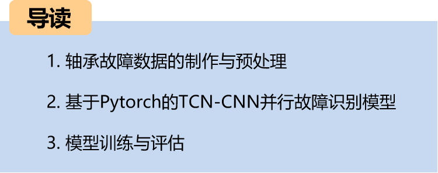
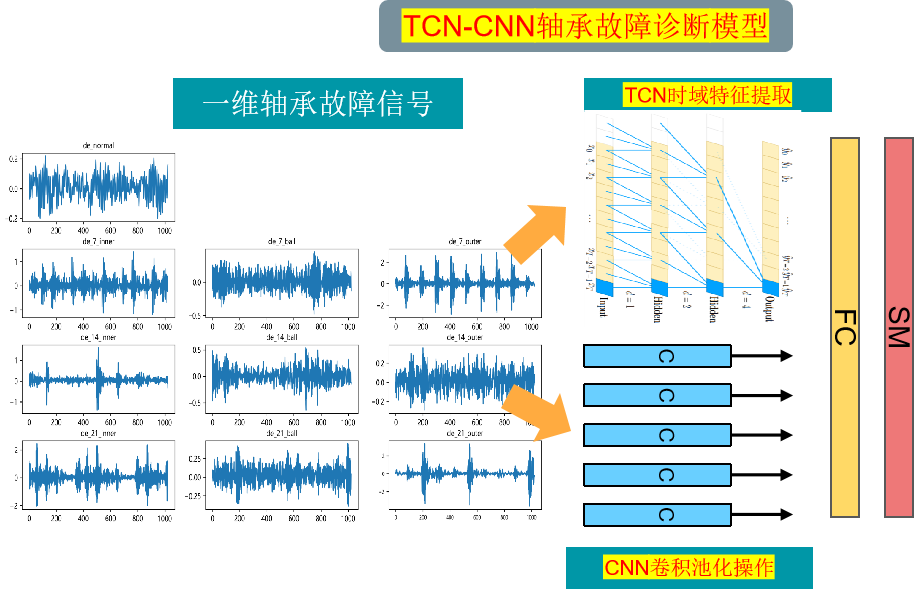
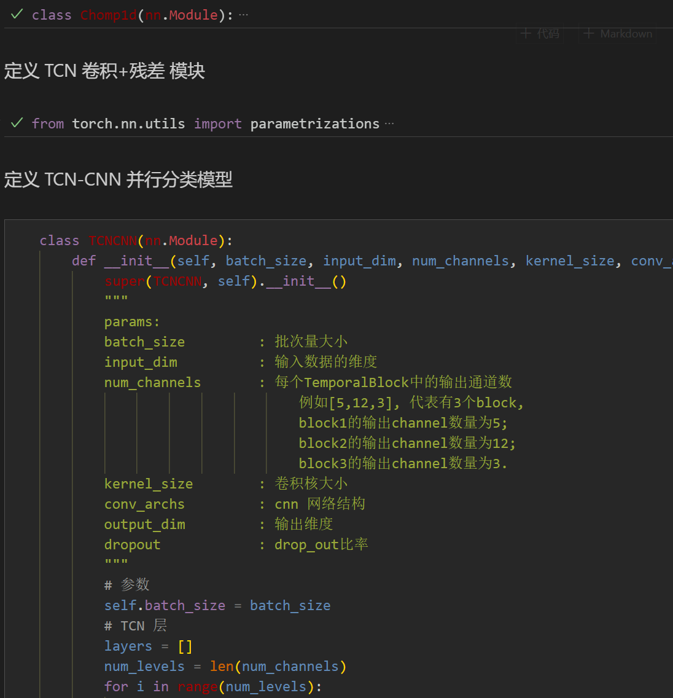
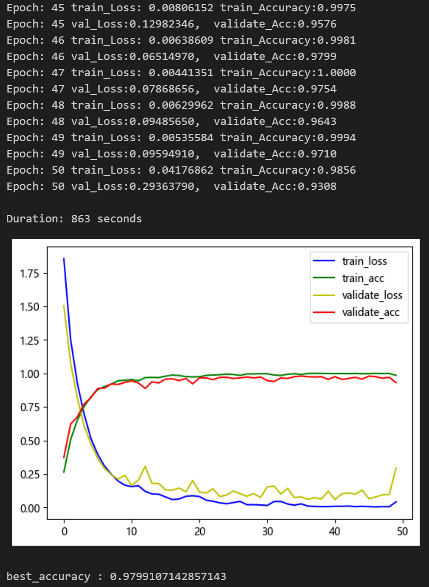
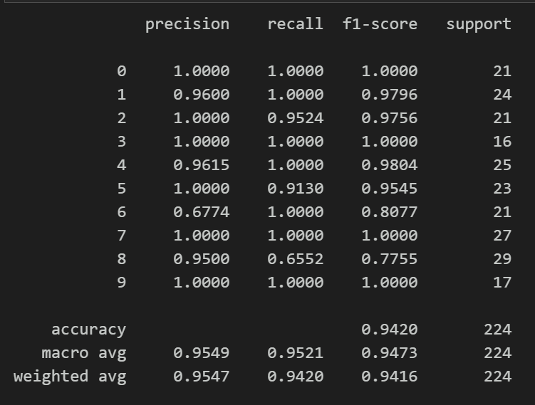
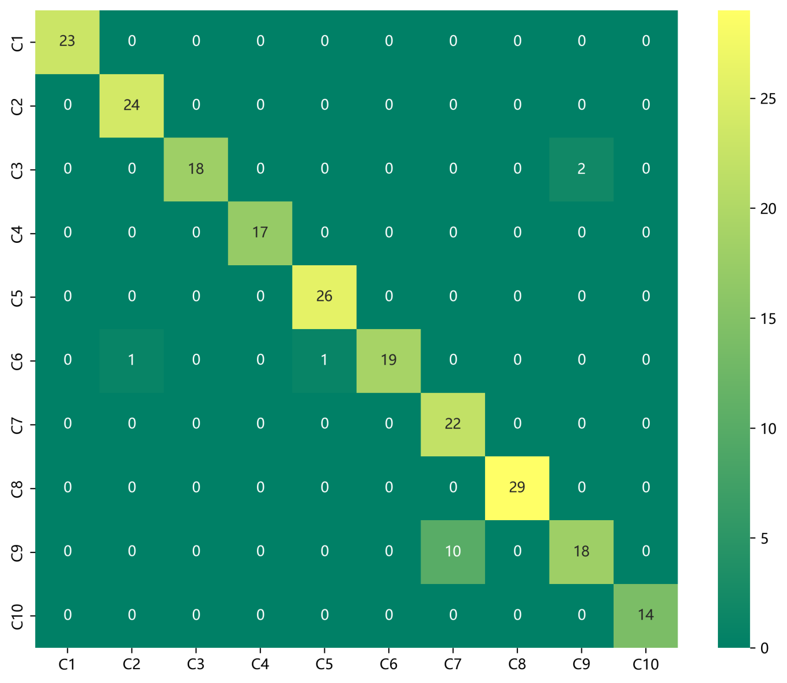
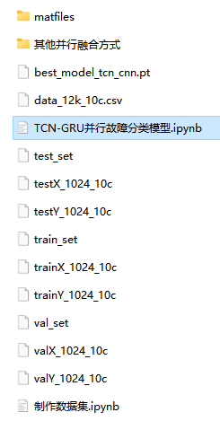

# Python Bearing Fault Diagnosis (17) One-Dimensional Fault Signal Recognition Model Based on TCN-CNN Parallel

Including the complete CWRU bearing fault dataset, as well as the fault signal dataset, classification data, and label set that have been generated and ready for use.
50 epochs, accuracy of 97%, the classification effect of TCN-CNN network is significant. The model can fully extract spatial and temporal features as well as frequency domain features of bearing fault signals, with fast convergence speed and superior performance, high precision. Innovation also exists!!!
Includes code for data preprocessing and TCN-CNN classification.
Environment: Python 3.9, PyTorch 1.8 and above.
The code contains three model fusion methods.
Preface
This article is based on the bearing data from Case Western Reserve University (CWRU), which first undergoes data preprocessing to create and load the dataset, and finally implements a TCN-CNN model for the classification of faulty data through Pytorch. For a detailed introduction to the bearing data from CWRU, please refer to the following text:
Python-Case Western Reserve University (CWRU) Bearing Data Interpretation and Classification Process
Overall Model Structure
The overall structure of the model is as follows:
1. Bearing Data Loading and Preprocessing
1.1 Import data
Refer to the previous article for preprocessing of fault classification 10, and the Case Western Reserve University bearing data set: Classification 10 dataset.
\ttrain_set, val_set, test_set are all divided into training set, validation set and test set according to the ratio of 7:2:1, and finally save data.
The above figure illustrates the data reading format and preprocessing approach.
1.2 Data preprocessing, dataset preparation
\t  
3. Tensor Convolutional Neural Network (TCN-CNN) Bearing Fault Diagnosis Classification Based on Pytorch
\t3.1 Define the TCN-CNN classification network model
\tNote: The input data dimension is [32, 1, 1024]. Firstly, it enters the CNN network for 1D convolutional pooling. Meanwhile, the signal is fed into the TCN layer to extract temporal features. Finally, spatial and temporal features are fused, and finally, they are fed into a fully connected layer and softmax for classification.
3.2 Set parameters and train the model
50 epochs, nearly 97% accuracy rate, TCN-CNN network classification effect is significant. The TCN-CNN model can fully extract the global spatial and time domain features of bearing fault signals, has a fast convergence speed, and its performance is particularly outstanding, with obvious effects.
\tNote: Adjust parameters.
\tIt is appropriate to increase the number of TCN layers and the dimensionality per layer, and fine-tune the learning rate.
Adjust the number of CNN layers and the number of neurons per layer, increasing more epochs (note to prevent overfitting).
\tThe shape of a one-dimensional signal stack can be changed (by setting the appropriate length and dimensions).
3.3 Model Evaluation
Accuracy, Precision, Recall, F1 Score
\tFault classification confusion matrix:
Previously Featured Content:
Python-Case Western Reserve University (CWRU) Bearing Data Interpretation and Classification Process
Python Bearing Fault Diagnosis (I) Short-Time Fourier Transform STFT
Python Bearing Fault Diagnosis (II) Continuous Wavelet Transform CWT
Python Bearing Fault Diagnosis (III) Empirical Mode Decomposition EMD
Pytorch-LSTM bearing fault one-dimensional signal classification (I)
Pytorch-CNN bearing fault one-dimensional signal classification (II)
Pytorch-Transformer bearing fault one-dimensional signal classification (III)
Python Bearing Fault Diagnosis (IV) Failure Classification Based on EMD-CNN
Python Bearing Fault Diagnosis (5) Fault Classification Based on EMD-LSTM
Python Bearing Fault Diagnosis (6) EMDA-Transformer-Based Fault Classification
Python Bearing Fault Diagnosis (7) EMDA-CNN-LSTM-Based Fault Classification
Python Bearing Fault Diagnosis (8) EMDA-CNN-GRU-Parallel Model-Based Fault Classification
Bearing Fault Identification Model Based on FFT + CNN - BiGRU-Attention for Time and Frequency Features Attention Fusion
Bearing Fault Identification Model Based on FFT + CNN - Transformer for Time and Frequency Features Integration
Python Bearing Fault Diagnosis (9) EMDA+CNN-BiLSTM-Based Fault Classification
Python Bearing Fault Diagnosis (10) EMDA+CNN-Transformer-Based Fault Classification
Python Bearing Fault Diagnosis (11) EMDA+CNN-BiGRU-Attention-Based Fault Classification
Cross Attention Fusion of Time and Frequency Features with Cross-Attention in FFT + CNN-BiLSTM-CrossAttention Bearing Fault Identification Model
Cross Attention Fusion of Time and Frequency Features with Cross-Attention in FFT + CNN-Transformer-CrossAttention Bearing Fault Identification Model
Python Bearing Fault Diagnosis Beginner's Guide
Python Bearing Fault Diagnosis (13) Super-Learning Machine Recognition Model Based on Fault Signal Feature Extraction

## Images

<!-- PAYMENT_BLOCK -->

## Get this dataset

- Payment link (Stripe): [Buy now](https://buy.stripe.com/3cs8yP7sY87d0vu9AB)
- Payment QR code: 

<!-- /PAYMENT_BLOCK -->
